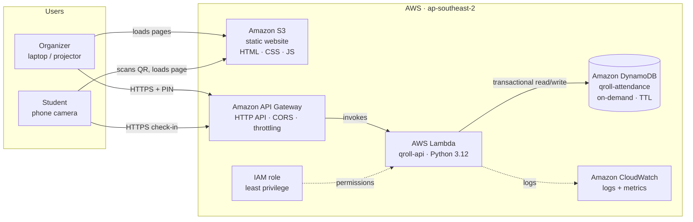
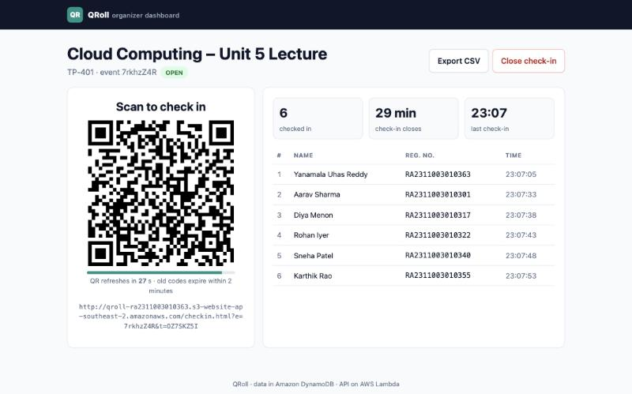
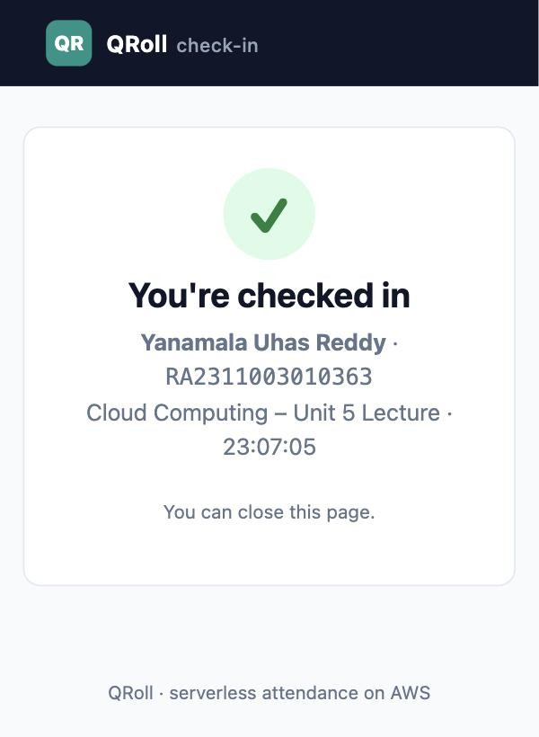

# QRoll: Serverless QR Attendance on AWS

**Course:** 21CSE362T – Cloud Computing · **Case study by:** Yanamala Uhas Reddy (RA2311003010363)
**Cloud platform:** Amazon Web Services: AWS Lambda · Amazon API Gateway · Amazon DynamoDB · Amazon S3

QRoll replaces the paper attendance sheet. The organizer projects a **QR code that changes every 30 seconds**. Students scan it with their phone camera, enter their name and register number, and appear on the organizer's dashboard within seconds. A photo of the QR forwarded on WhatsApp stops working within 2 minutes, and the same register number cannot check in twice.

The whole system is **serverless**. No virtual machine is running, it costs nothing while idle, and it scales automatically from 5 students to 5,000.

| | |
|---|---|
| 🌐 **Live app** | <http://qroll-ra2311003010363.s3-website-ap-southeast-2.amazonaws.com> |
| ⚙️ **Live API** | `https://m2tkf1r146.execute-api.ap-southeast-2.amazonaws.com` |
| 🗺️ **Region** | Asia Pacific (Sydney) `ap-southeast-2` |
| ✅ **End-to-end test** | 10 / 10 checks passed against the live API |

---

## The case in one picture



## What makes it more than a form

| Problem in a real classroom | How QRoll solves it (on AWS) |
|---|---|
| Friends mark proxy attendance | QR token is an **HMAC that rotates every 30 s**; Lambda rejects tokens older than 2 min (HTTP 403) |
| Same student submits twice | DynamoDB **conditional write** `attribute_not_exists(SK)` → HTTP 409 |
| Late check-ins after the class | Check-in window plus a **"Close" button**, enforced inside a DynamoDB **transaction** → HTTP 410 |
| Paper sheets are typed up later | Live dashboard plus **CSV export** |
| Servers cost money while idle | Lambda + DynamoDB on-demand: **pay per request, ₹0 when idle** |
| Old data piles up | DynamoDB **TTL** deletes event data 7 days after it closes |
| Anyone could read the list | Organizer actions need a PIN, stored as a **PBKDF2 salted hash** |

## Repository structure

```
qroll/
├── backend/
│   └── lambda_function.py            ← the whole API (6 routes) in one Lambda function
├── frontend/                          ← static site hosted on S3
│   ├── index.html                     ← organizer: create event
│   ├── event.html                     ← organizer: live QR + attendee dashboard
│   ├── checkin.html                   ← student: check-in form (opened by the QR)
│   ├── app.js · app.css · config.js
├── infra/
│   ├── deploy.sh                      ← creates/updates every AWS resource (AWS CLI)
│   ├── smoke-test.sh                  ← 10 end-to-end checks against the live API
│   ├── cleanup.sh                     ← deletes every resource
│   ├── lambda-trust-policy.json
│   └── lambda-permissions-policy.json ← least-privilege IAM policy
├── docs/                              ← case-study write-up (one file per rubric item)
├── screenshots/                       ← evidence from the live run
└── PPT/
    └── QRoll_Case_Study/
        ├── QRoll_Case_Study.pptx      ← presentation
        └── build_ppt.py
```

## Rubric coverage

| # | Criterion | Marks | Evidence |
|---|---|:-:|---|
| 1 | Tool introduction | 1 | [docs/01-tool-introduction.md](docs/01-tool-introduction.md) |
| 2 | Service exploration (IaaS / PaaS / SaaS) | 2 | [docs/02-service-exploration.md](docs/02-service-exploration.md) |
| 3 | Practical demonstration | 2 | [docs/03-practical-demonstration.md](docs/03-practical-demonstration.md) · live app · [screenshots/](screenshots/) |
| 4 | Features, benefits, applications | 2 | [docs/04-features-benefits-applications.md](docs/04-features-benefits-applications.md) |
| 5 | Real-time application | 1 | [docs/05-real-time-application.md](docs/05-real-time-application.md) |

## Deploy it yourself

Requirements: AWS account, AWS CLI v2 signed in (`aws login` or `aws configure`), `zip`, `curl`, `python3`.

```bash
cd infra
./deploy.sh qroll-<your-unique-name> ap-southeast-2     # about 1 minute; prints the website + API URLs
./smoke-test.sh https://<api-id>.execute-api.ap-southeast-2.amazonaws.com
./cleanup.sh qroll-<your-unique-name> ap-southeast-2    # removes everything
```

## Screenshots

| Organizer dashboard (live) | Student phone |
|---|---|
|  |  |

More in [screenshots/](screenshots/) and [docs/03-practical-demonstration.md](docs/03-practical-demonstration.md).
