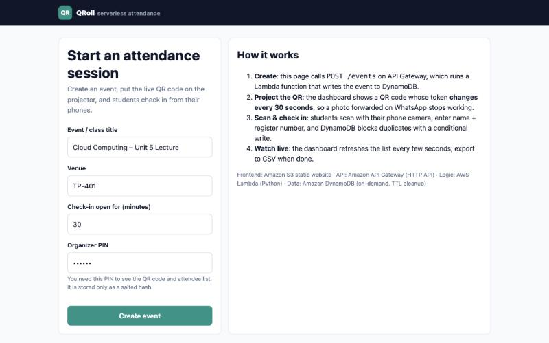
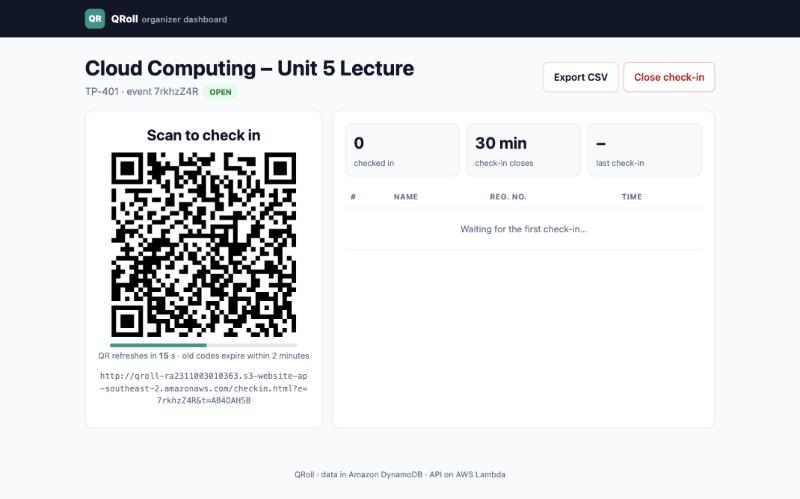
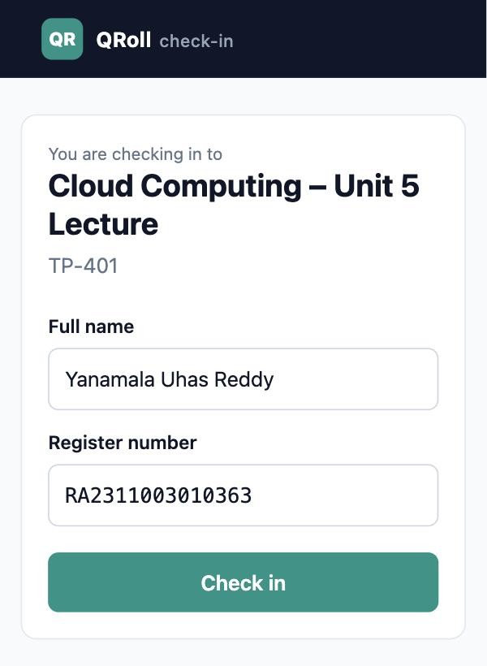
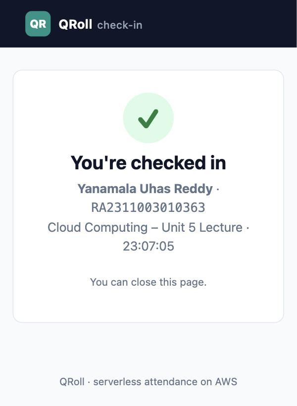
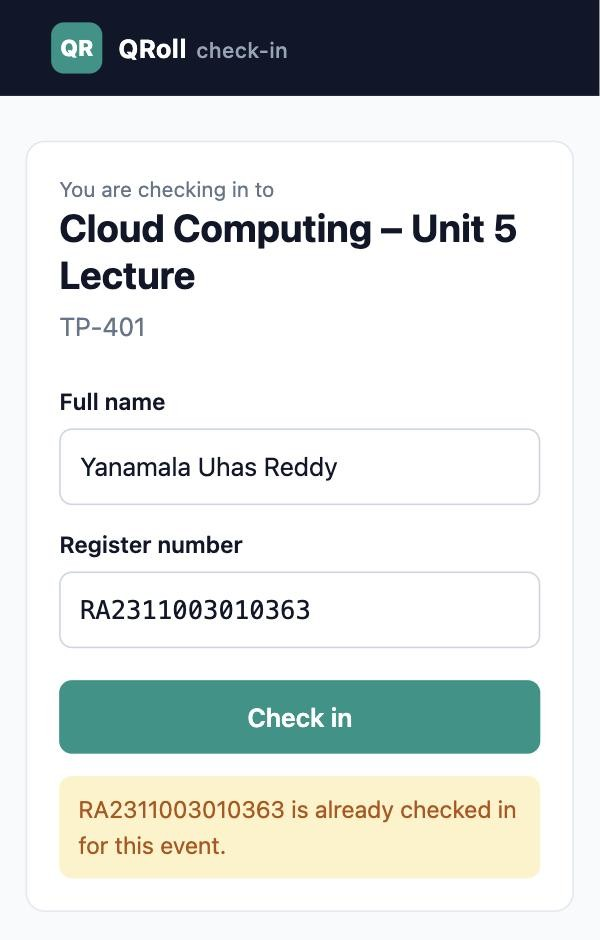
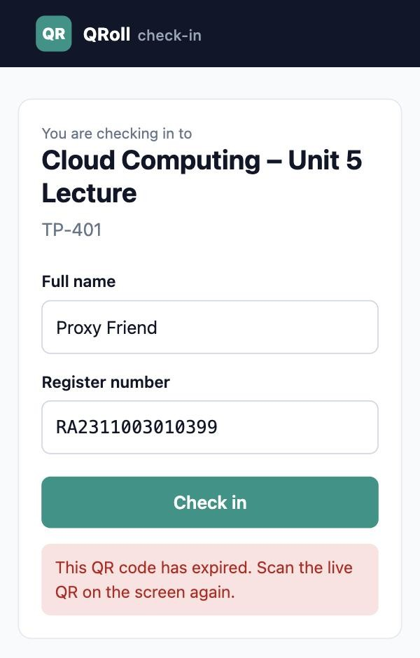
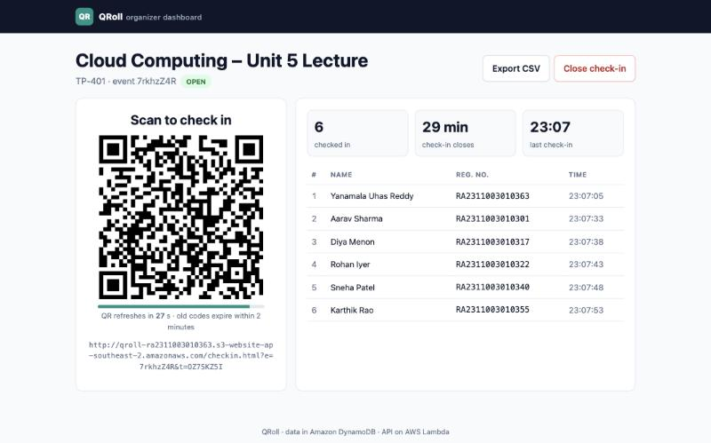
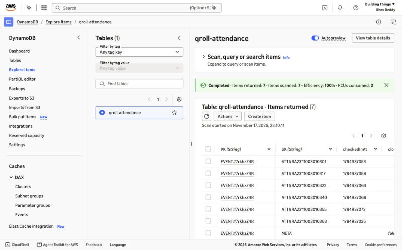
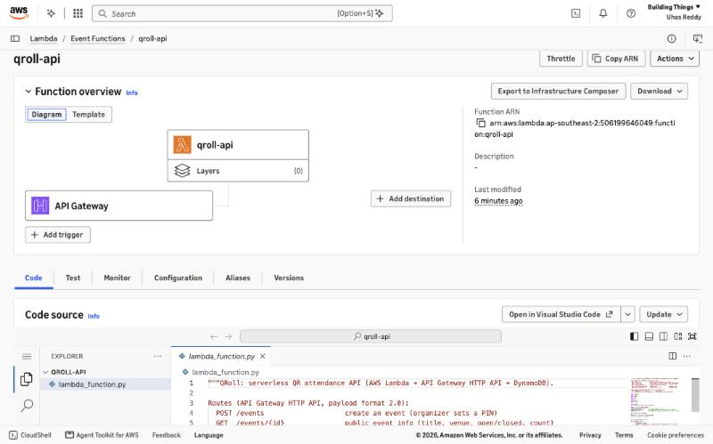
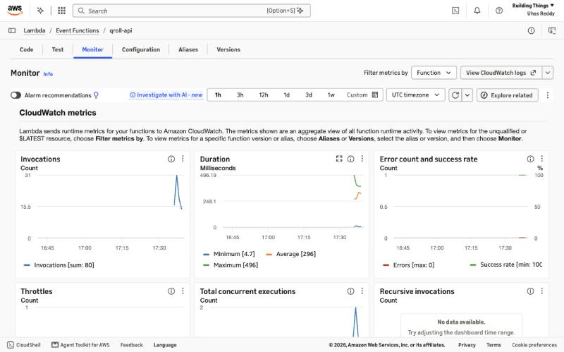

# 3. Practical Demonstration — *2 marks*

QRoll was deployed to a real AWS account and tested on **17 Nov 2026** in **Asia Pacific (Sydney) `ap-southeast-2`**. The new account's free plan allows one Region.

## 3.1 Architecture

```
 Organizer browser ──┐                         ┌──────────────── AWS (ap-southeast-2) ────────────────┐
                     │  GET pages (HTTP)       │                                                      │
 Student phone ──────┼────────────────────────►│  Amazon S3 website  (index / event / checkin .html)  │
   (scans QR)        │                         │                                                      │
                     │  JSON over HTTPS        │  Amazon API Gateway  ──invoke──►  AWS Lambda          │
                     └────────────────────────►│  (CORS, throttling)               qroll-api (Python)  │
                                               │                                        │             │
                                               │                     IAM role ─────────┤             │
                                               │                     (this table only)  ▼             │
                                               │                              Amazon DynamoDB         │
                                               │                              qroll-attendance        │
                                               │  Amazon CloudWatch ◄── logs + metrics ──┘             │
                                               └──────────────────────────────────────────────────────┘
```

### API
| Route | Who | What Lambda does |
|---|---|---|
| `POST /events` | Organizer | Validates input, hashes PIN (PBKDF2 + salt), creates a random 256-bit QR secret, writes `EVENT#id / META` |
| `GET /events/{id}` | Anyone | Returns title, venue, open/closed, count. Never returns the secret or PIN hash |
| `GET /events/{id}/qr` | Organizer (PIN) | Returns the current token = first 8 base32 chars of `HMAC-SHA256(secret, "id:⌊now/30⌋")` |
| `POST /events/{id}/checkin` | Student | Checks token (current + 3 previous windows); runs a DynamoDB transaction (unique attendee + event still open + count++) |
| `GET /events/{id}/attendees` | Organizer (PIN) | `Query` on `PK = EVENT#id AND begins_with(SK, "ATT#")` |
| `POST /events/{id}/close` | Organizer (PIN) | Sets `closed = true`; later check-ins get HTTP 410 |

## 3.2 Deployment steps
Everything is created by [`infra/deploy.sh`](../infra/deploy.sh) with the AWS CLI. The same steps can be clicked through in the Console.

| # | Step | AWS CLI call (simplified) | Console equivalent |
|---|---|---|---|
| 1 | Create the table | `aws dynamodb create-table --billing-mode PAY_PER_REQUEST` (PK, SK) + `update-time-to-live` | DynamoDB → Create table |
| 2 | Create the Lambda role | `aws iam create-role` + `put-role-policy` ([policy](../infra/lambda-permissions-policy.json)) | IAM → Roles → Create role |
| 3 | Deploy the function | `zip` + `aws lambda create-function --runtime python3.12` | Lambda → Create function → upload .zip |
| 4 | Create the HTTP API | `aws apigatewayv2 create-api` + 6× `create-route` + `create-stage` (throttling) + `lambda add-permission` | API Gateway → Create HTTP API → add routes |
| 5 | Host the website | `aws s3 mb` + `s3 website` + bucket policy + `s3 sync` (writes `config.js` with the API URL) | S3 → Create bucket → Static website hosting |

Output of the real run:
```
✅ QRoll is live
   Website : http://qroll-ra2311003010363.s3-website-ap-southeast-2.amazonaws.com
   API     : https://m2tkf1r146.execute-api.ap-southeast-2.amazonaws.com
```

## 3.3 Automated end-to-end test (live API)
[`infra/smoke-test.sh`](../infra/smoke-test.sh) output:
```
  PASS  create event (HTTP 201)
  PASS  wrong PIN rejected (HTTP 401)
  PASS  organizer gets QR token (HTTP 200)
  PASS  check-in (HTTP 201)
  PASS  duplicate blocked (HTTP 409)
  PASS  forged token rejected (HTTP 403)
  PASS  attendee list (HTTP 200)
  PASS  close event (HTTP 200)
  PASS  late check-in rejected (HTTP 410)
  PASS  unknown event (HTTP 404)

10 passed, 0 failed
```

## 3.4 Live demo script (what to show in class)
1. **Create the event**: open the website, enter title, venue, minutes and PIN, then click *Create event*.
2. **Project the QR**: the dashboard shows the QR and a 30-second countdown bar; the QR changes when it hits zero.
3. **Check in from a phone**: scan, type name and register number, tap *Check in*. A green ✓ appears.
4. **Watch it appear live**: the dashboard row flashes and the counter increments (polling every 4 s).
5. **Try to cheat**:
   - Submit the same register number again → *"already checked in"* (409).
   - Open an old QR link after 2 minutes → *"QR code has expired"* (403).
6. **Show the cloud side**: DynamoDB *Explore items* (the `META` and `ATT#…` rows), the Lambda function with its API Gateway trigger, and CloudWatch invocations, duration and errors.
7. **Close + export**: *Close check-in* (later attempts get 410), then *Export CSV*.

## 3.5 Evidence from the live run

| 1 · Create event | 2 · Live rotating QR |
|---|---|
|  |  |

| 3 · Student form (phone) | 4 · Checked in | 5 · Duplicate blocked | 6 · Expired QR rejected |
|---|---|---|---|
|  |  |  |  |

**Dashboard after 6 check-ins** (the QR token has already rotated):


| DynamoDB items (single-table design) | Lambda function with API Gateway trigger |
|---|---|
|  |  |

**CloudWatch**: 80 invocations during testing, **0 errors, 100% success**. Duration ranged from 4.7 ms (warm) to 496 ms (cold start).


> The sample classmates in the screenshots are demo data entered for testing.

## 3.6 Clean-up
`./cleanup.sh qroll-ra2311003010363 ap-southeast-2` deletes the API, function, log group, IAM role, table and bucket.
