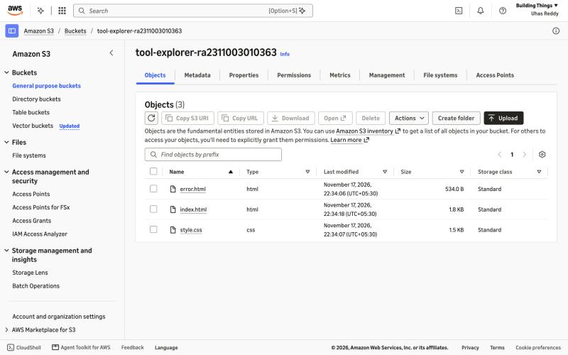
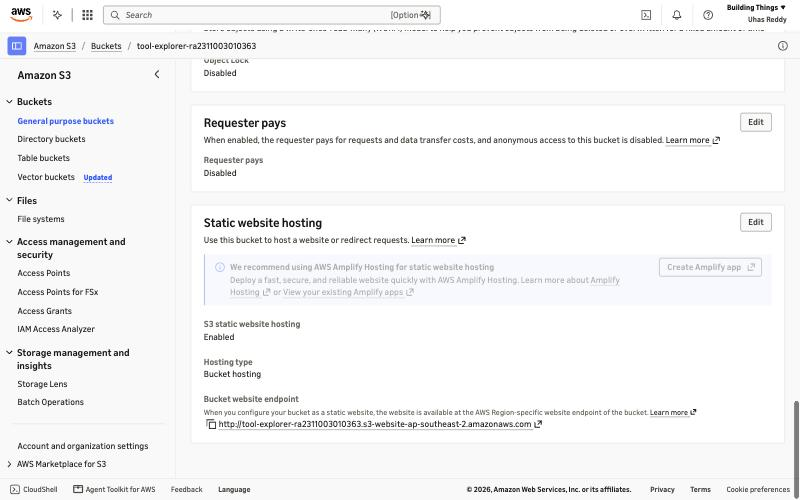
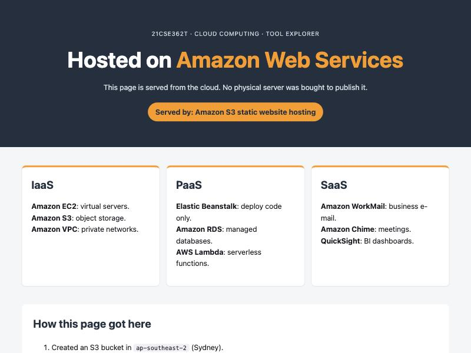
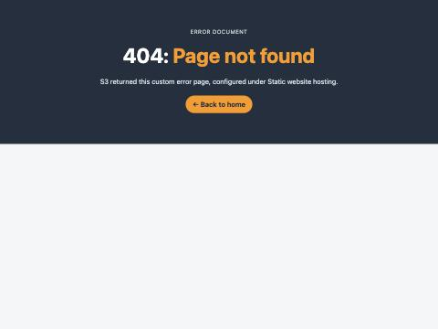
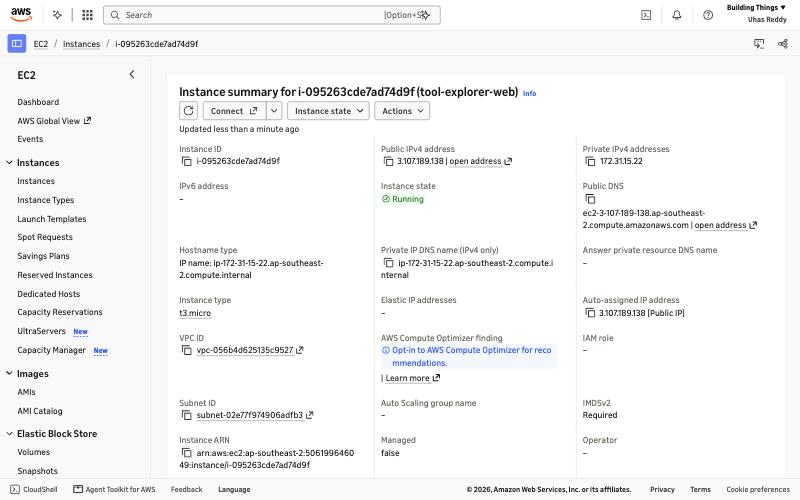
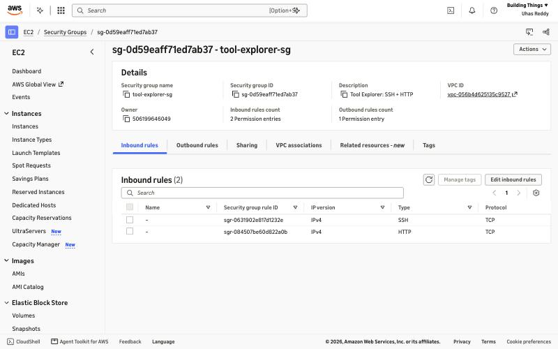
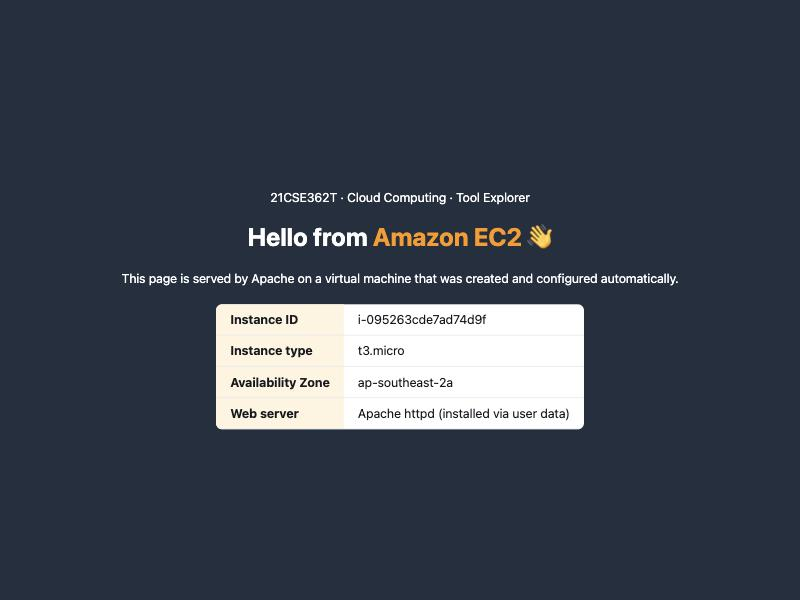

# 3. Practical Demonstration — *2 Marks*

I show **two basic operations** on AWS using the website in [`demo/website/`](../demo/website/):

| Demo | Service | Model | What it proves |
|---|---|---|---|
| **A** | Amazon S3 static website hosting | IaaS (storage) | Create a bucket, upload files, set a public policy, get a live URL |
| **B** | Amazon EC2 web server | IaaS (compute) | Launch a VM, configure a firewall (security group), auto-install Apache, open it in a browser |

> 💡 Both demos fit in the **AWS Free Tier**. Run [`cleanup.sh`](../demo/scripts/cleanup.sh) afterwards so you are not charged.

---

## Prerequisites
1. Create an AWS account at <https://aws.amazon.com/free>.
2. **Do not use the root user.** In **IAM → Users → Create user**, create a user with the `AdministratorAccess` policy (or `AmazonS3FullAccess` + `AmazonEC2FullAccess`). Unit III covers identity and access management.
3. *(For the CLI path)* Install AWS CLI v2 and run:
   ```bash
   aws configure
   # AWS Access Key ID:     <from IAM user → Security credentials>
   # AWS Secret Access Key: <...>
   # Default region name:   ap-south-1      (Mumbai)
   # Default output format: json
   ```

---

## Demo A: Host a static website on Amazon S3

### Console steps
1. Open **S3** → **Create bucket**.
2. **Bucket name:** a globally unique name, e.g. `tool-explorer-yourname-2026`. **Region:** `ap-south-1`.
3. Under **Block Public Access settings**, untick *Block all public access* and acknowledge the warning.
4. Click **Create bucket**.
5. Open the bucket → **Upload** → add `index.html`, `error.html`, `style.css` → **Upload**.
6. **Properties** tab → **Static website hosting** → **Edit** → *Enable* → Index document `index.html`, Error document `error.html` → **Save**.
7. **Permissions** tab → **Bucket policy** → **Edit** → paste [`bucket-policy.json`](../demo/scripts/bucket-policy.json) (replace `BUCKET_NAME`) → **Save**.
8. Back in **Properties → Static website hosting**, copy the **Bucket website endpoint**, e.g.
   `http://tool-explorer-yourname-2026.s3-website.ap-south-1.amazonaws.com`, and open it. ✅ The site is live.
9. Test the error page by opening `/does-not-exist`. It shows `error.html`.

### CLI equivalent
```bash
cd demo/scripts
./deploy-s3-website.sh tool-explorer-yourname-2026
```
The script runs `aws s3 mb`, `put-public-access-block`, `s3 website`, `put-bucket-policy` and `s3 sync`, then prints the URL.

---

## Demo B: Launch a web server on Amazon EC2

### Console steps
1. Open **EC2** → **Launch instance**.
2. **Name:** `tool-explorer-web`.
3. **AMI:** *Amazon Linux 2023* (Free tier eligible). The AMI is the VM image (Unit IV).
4. **Instance type:** `t2.micro` / `t3.micro` (Free tier).
5. **Key pair:** *Create new key pair* → `tool-explorer-key` → RSA, `.pem` → download it.
6. **Network settings → Create security group:**
   - Allow **SSH (22)** from *My IP*
   - Allow **HTTP (80)** from *Anywhere (0.0.0.0/0)*

   A security group is a **virtual firewall** for the instance.
7. **Advanced details → User data:** paste the contents of [`ec2-user-data.sh`](../demo/scripts/ec2-user-data.sh). It installs Apache and writes the web page on first boot.
8. Click **Launch instance**. Wait until **Instance state = Running** and **Status checks = 2/2 passed**.
9. Copy the **Public IPv4 address** and open `http://<public-ip>` in a browser. ✅ The page shows the instance ID and Availability Zone, read live from the EC2 metadata service.
10. *(Optional)* Connect with **EC2 Instance Connect** or SSH:
    ```bash
    chmod 400 tool-explorer-key.pem
    ssh -i tool-explorer-key.pem ec2-user@<public-ip>
    sudo systemctl status httpd
    ```
11. **Monitoring** tab: show CPU utilisation graphs from **CloudWatch**.

### CLI equivalent
```bash
cd demo/scripts
./launch-ec2-webserver.sh
```
The script looks up the latest Amazon Linux 2023 AMI, creates a key pair and a security group (ports 22 and 80), runs the instance with the user-data script, waits for it, and prints the URL.

---

## Clean-up (important)
| Resource | How to delete |
|---|---|
| EC2 instance | EC2 → Instances → select → **Instance state → Terminate** |
| Security group / key pair | EC2 → Security Groups / Key Pairs → Delete |
| S3 bucket | S3 → bucket → **Empty**, then **Delete** |

Or run: `./cleanup.sh tool-explorer-yourname-2026`

---

## What I learned from the demo
- **On-demand self-service:** a server was running within about 1 minute, with no hardware purchase.
- **Virtualization:** the EC2 instance is a VM created from an AMI on the Nitro hypervisor.
- **Security:** least-privilege IAM user, security-group firewall rules, and S3 Block Public Access defaults.
- **Measured service:** usage is visible in CloudWatch and in the Billing dashboard.
- **IaaS responsibility:** on EC2 *I* installed and configured Apache. On S3 AWS ran the web server for me.

## Actual run (17 Nov 2026)

Both demos were run on a real AWS account with the scripts in this repo.

> **Region note:** a new account on the AWS free plan can only use one Region (here **Asia Pacific (Sydney) `ap-southeast-2`**), so the demo ran there instead of Mumbai. The scripts take the Region as an argument: `./deploy-s3-website.sh <bucket> ap-southeast-2`.

| Item | Result |
|---|---|
| S3 bucket | `tool-explorer-ra2311003010363` (3 objects) |
| S3 website URL | <http://tool-explorer-ra2311003010363.s3-website.ap-southeast-2.amazonaws.com> (HTTP 200; `/does-not-exist` → custom 404 page) |
| EC2 instance | `i-095263cde7ad74d9f`, `t3.micro`, Amazon Linux 2023, AZ `ap-southeast-2a` |
| Security group | `tool-explorer-sg`: TCP 22 from my IP only, TCP 80 from `0.0.0.0/0` |
| EC2 website | `http://3.107.189.138` served the Apache page about 1 min after launch |
| Clean-up | EC2 instance **terminated**, security group and key pair **deleted**. The S3 site was kept live for the evaluation. |

### Screenshots

**Demo A: Amazon S3**

| Bucket objects | Static website hosting enabled |
|---|---|
|  |  |
| **Live website** | **Custom error page (404)** |
|  |  |

**Demo B: Amazon EC2**

| Instance running | Security group (inbound rules) |
|---|---|
|  |  |

**Live page served by Apache on the EC2 instance** (instance ID and AZ read from instance metadata):


